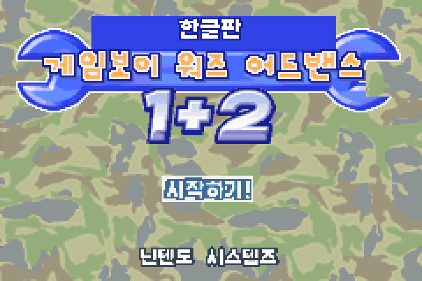
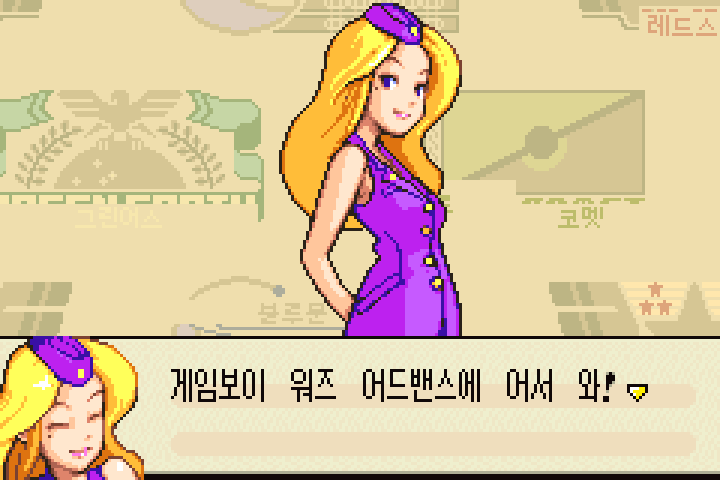
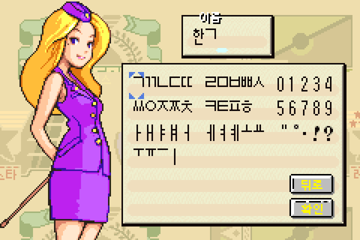
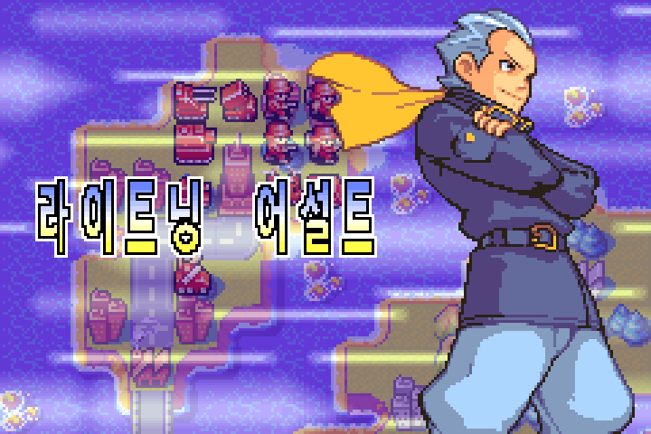
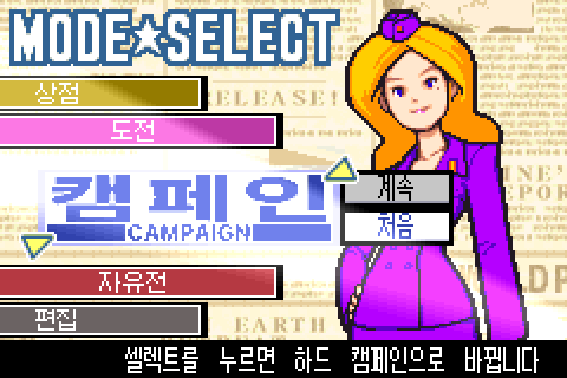
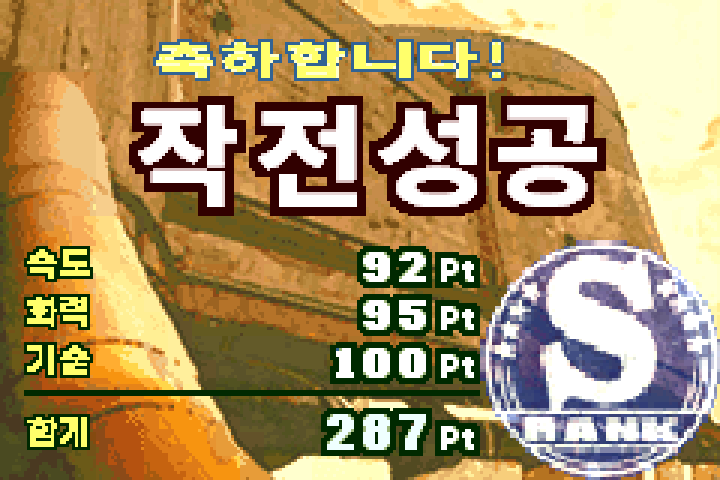

# 게임보이 워즈 어드밴스 1+2 한글 패치

일본판 GBA 게임 **ゲームボーイウォーズアドバンス1+2** (Game Boy Wars Advance 1+2)를
한국어로 즐길 수 있게 해 주는 비공식 팬 번역 패치입니다.

- **버전:** 2026-11-14 판
- **받기:** [Releases](https://github.com/hada0127/aw-kor/releases/latest) 페이지의 `aw_kor_2026-11-14.xdelta`
- 이 저장소에는 **게임 ROM이 들어 있지 않습니다.** 본인이 정당하게 가진 일본판 ROM에 패치를 적용해 주세요.

| | |
|---|---|
|  |  |
|  |  |
|  |  |

---

## 무엇이 한글로 바뀌나요

1편·2편 모두 바뀝니다.

- **대사·메뉴·시스템 메시지:** 스토리 대사, 튜토리얼, 도움말, 유닛·지형·사령관 이름까지 모두 한국어입니다.
  일본어 원문을 보고 대사를 한국어답게 다시 다듬었습니다.
- **그림으로 된 글자:** 게임 제목 로고(「게임보이 워즈 어드밴스」), 미션 제목, 「N일째 / 작전개시」 배너,
  「작전성공」·「승리!」 같은 결과 화면, 사령관 파워 컷인 이름, 2편 모드 선택판까지 일본판 글꼴 느낌에 맞춰 새로 그렸습니다.
- **한글 이름 입력:** 1편 주인공·맵 이름, 2편 맵 에디터 이름 칸에서 두벌식처럼 자음·모음을 골라 한글을 조합해 입력할 수 있습니다.
- **문장부호:** 쉼표·마침표는 한국식 모양으로, 「・・・」는 한 칸짜리 「…」로 바꿨습니다.
- 예/아니오 선택지는 「예 / 아뇨」로 통일했습니다.

일부러 원본 그대로 둔 것:

- 화면 머리글의 영문 표기(MODE★SELECT 등)와 지도 위의 작은 영문 장식 — 일본판도 영문입니다.
- 엔딩 스태프 이름 — 원문(가타카나) 그대로입니다.

---

## 준비물

1. **일본판 ROM** — `Game Boy Wars Advance 1+2 (Japan).gba` (16MB)
   - 해외판(Advance Wars 등)이나 다른 덤프에는 적용되지 않습니다. 아래 값과 같아야 합니다.

   | 항목 | 값 |
   |---|---|
   | 크기 | 16,777,216 바이트 |
   | CRC32 | `49EE1FDD` |
   | SHA-256 | `a8ad7c7d2a48b4ce4d7a5da408121e9640206ed9f040c0ac967b6c6b2413831c` |

2. **패치 파일** — [최신 릴리스](https://github.com/hada0127/aw-kor/releases/latest)에서 `aw_kor_2026-11-14.xdelta` 를 받습니다.
   (xdelta = VCDIFF 형식입니다.)

---

## 패치 적용 방법

편한 방법 하나를 고르세요.

### 방법 1 — 웹 브라우저 (설치 없음, 권장)

1. [Rom Patcher JS](https://www.marcrobledo.com/RomPatcher.js/)를 엽니다.
2. **ROM file** 칸에 일본판 `.gba`, **Patch file** 칸에 `.xdelta` 를 넣습니다.
3. **Apply patch** 를 누르면 한글판 `.gba` 가 저장됩니다.

파일은 브라우저 안에서만 처리되고 어디에도 올라가지 않습니다.

### 방법 2 — Delta Patcher (Windows·macOS·Linux)

1. [Delta Patcher](https://github.com/marco-calautti/DeltaPatcher/releases)를 실행합니다.
2. **Original file** 에 일본판 `.gba`, **XDelta patch** 에 `.xdelta` 를 고르고 **Apply patch** 를 누릅니다.
   (원본 파일이 바뀌므로 먼저 복사본을 만들어 두세요.)

### 방법 3 — 명령줄 xdelta3

```
xdelta3 -d -s "Game Boy Wars Advance 1+2 (Japan).gba" aw_kor_2026-11-14.xdelta "Game Boy Wars Advance 1+2 (Korean).gba"
```

### 결과 확인

패치한 ROM이 아래 값과 같으면 정상입니다.

| 항목 | 값 |
|---|---|
| 크기 | 16,777,216 바이트 |
| CRC32 | `E936CE1B` |
| SHA-256 | `49e42333052937e78962e181dd99ae44bdd177d7efa02595e298ec6248ba46af` |

```
# macOS / Linux
shasum -a 256 "Game Boy Wars Advance 1+2 (Korean).gba"

# Windows (PowerShell)
Get-FileHash "Game Boy Wars Advance 1+2 (Korean).gba" -Algorithm SHA256
```

값이 다르면 원본 ROM이 다른 덤프일 가능성이 큽니다. 위 「준비물」의 원본 값을 먼저 확인해 주세요.

---

## 플레이 방법

- [mGBA](https://mgba.io/), RetroArch의 mGBA 코어 등 GBA 에뮬레이터에서 패치한 `.gba` 를 열면 됩니다.
  PC 에뮬레이터와 아이폰 RetroArch에서 확인했습니다.
- 실제 GBA 본체·플래시 카트에서는 따로 시험하지 않았습니다.

### 세이브

- 세이브 형식은 **플래시 1Mbit(128KB)** 입니다. 대부분의 에뮬레이터는 자동으로 알아봅니다.
- 패치는 세이브 형식을 바꾸지 않아서, 예전 판에서 쓰던 `.sav` 를 그대로 이어 쓸 수 있습니다. 바꾸기 전에 **`.sav` 를 꼭 백업**하세요.
- 에뮬레이터의 **상태 저장(세이브 스테이트)** 은 다른 판 ROM으로 옮겨 쓰지 마세요. 게임 안의 세이브로 이어서 하세요.

---

## 이번 판에서 바뀐 점 (2026-11-14)

지난 2026-10-21 판과 비교해:

- 게임 제목 로고와 게임 안 표기를 「게임보이 워즈 어드밴스」로 되돌렸습니다.
- 1·2편 대사 약 3,700개를 일본어 원문 기준으로 더 자연스럽게 다시 썼고, 사령관·유닛 명칭을 정리했습니다.
- 1편 이름 입력에서도 한글 조합 입력을 쓸 수 있고, 두 편 모두 받침이 조합 안 되는 경우 다음 글자로 자동으로 넘깁니다.
- 결과·승리 화면, 미션 제목, 컷인 이름, 작은 이름표·머리말 등 그림 글자를 일본판 스타일에 맞춰 다시 그렸습니다.
- 한국식 쉼표·마침표, 한 칸짜리 말줄임표, 2편 일반 글자 색(검정)을 바로잡았습니다.

---

## 알려진 한계

- 1편·2편 모두 엔딩까지 모든 분기를 일반 플레이로 끝까지 확인하지는 못했습니다.
  드물게 나오는 화면(3인 이상 대전, 통신 대전 일부 등)에는 어색한 줄바꿈·배치나 일본어가 남아 있을 수 있습니다.
- 2편 맵 에디터 이름 입력에서 「뢨·썅·쏀·쓩·쭁」 5글자는 조합으로 만들 수 없습니다.

오류를 발견하면 [Issues](https://github.com/hada0127/aw-kor/issues)에 화면 캡처와 함께 어느 편·어느 장면인지 알려 주세요.

---

## 만든 사람들

- **원 번역·감수·도트 그래픽:** B팀 · 쪼롱이님
- **대사 재작성·한글 출력 기술·그래픽·빌드·검수:** 이 저장소의 한글화 팀
- **사용 글꼴**
  - 갈무리(Galmuri) — 이민서(Lee Minseo), SIL Open Font License 1.1 — 대사·메뉴 등 작은 글씨
  - 하다 산스(Hada Sans) — Hada Type Foundry, SIL Open Font License 1.1 — 미션 제목·배너·결과 화면 등 그림 글자
  - OK단단(OkDanDan-Bold) — 오케이티콘, 상업 무료 — 게임 제목 로고 등 둥근 그림 글자

---

## 라이선스와 면책

- 이 패치는 **비공식 팬 번역**입니다. 닌텐도(Nintendo), 인텔리전트 시스템즈(Intelligent Systems) 및
  원작 권리자와 아무 관계가 없습니다. 게임의 저작권은 원저작권자에게 있습니다.
- **ROM 파일이나 패치를 적용한 ROM을 올리거나 나눠 주지 마세요.** 이 저장소는 패치·도구·문서만 배포합니다.
- 글꼴은 위에 적은 각 글꼴의 라이선스를 따릅니다.
- 패치 사용으로 생긴 문제에 대해 책임지지 않습니다. 세이브는 미리 백업하세요.

---

## 개발자용 문서

- [`docs/DEVELOPER_GUIDE.md`](docs/DEVELOPER_GUIDE.md) — 개발 환경, ROM 빌드, 품질 검사 도구, 프로젝트 구조
- [`docs/REVIEWER_GUIDE.md`](docs/REVIEWER_GUIDE.md) — 배포본 검증 방법, 증거 위치
- [`CONTRIBUTING.md`](CONTRIBUTING.md) — 기여 방법
